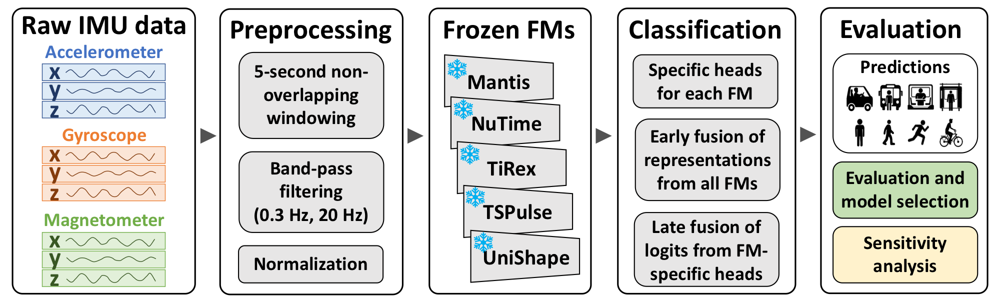
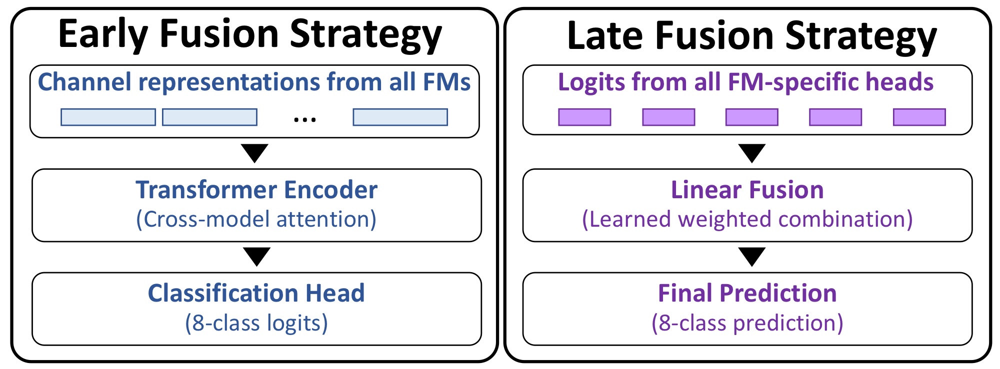
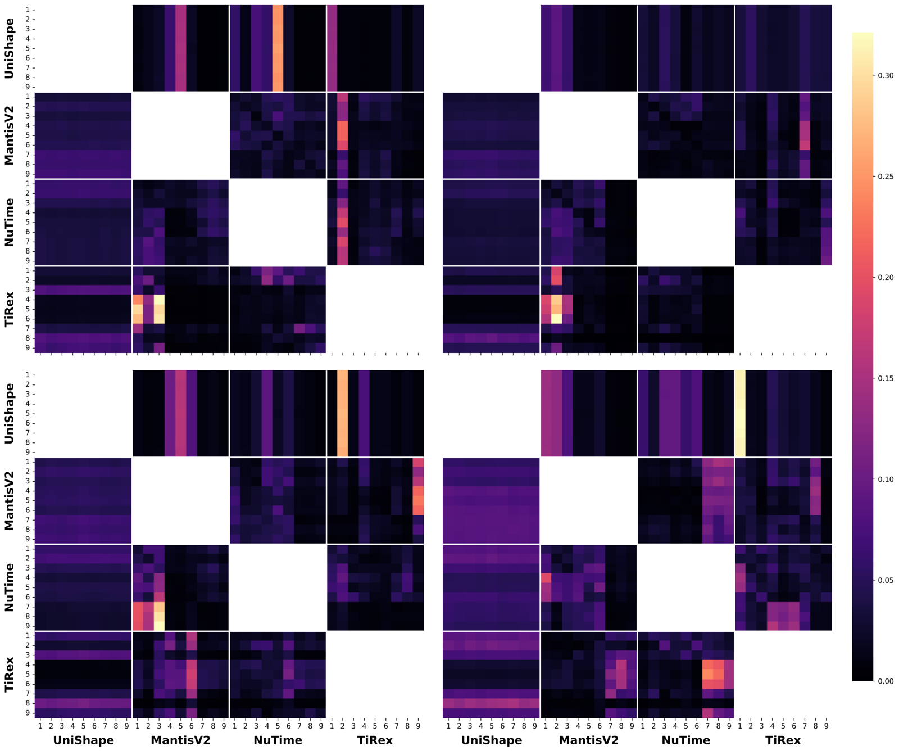

# Early and Late Fusion of Frozen Foundation Models for IMU-Based Human Activity Recognition

Code from the UT-IR team's submission to the [SHL Recognition Challenge 2026](http://www.shl-dataset.org/). The task is to recognize eight transportation and locomotion modes (Still, Walk, Run, Bike, Car, Bus, Train, Subway) from smartphone IMU data, with every foundation model (FM) kept frozen.



> [!IMPORTANT]
> This repository contains only:
> - the classification head used for **UniShape** and **MantisV2** ([`src/model/classifier/attn_classifier.py`](src/model/classifier/attn_classifier.py))
> - the **early-fusion ensemble** ([`src/model/ensemble.py`](src/model/ensemble.py))
>
> It does not run **TiRex** or **TSPulse**, and it does not include the NuTime, TiRex or TSPulse classification heads or the late-fusion code. NuTime features are still extracted, because the ensembles use them. Reproducing the ensemble results that use TiRex or TSPulse features requires extracting those features yourself; see [Features from TiRex and TSPulse](#features-from-tirex-and-tspulse).

## Method

Each 5-second, 9-channel window (tri-axial accelerometer, gyroscope and magnetometer) is encoded by frozen foundation models. Only the lightweight models on top of these frozen features are trained.



### FM-specific classification head

`AttnClassifier` is the head used for UniShape and MantisV2. It takes the per-channel embeddings `(B, 9, D)` of one FM and runs them through the following steps:
1. Projects them to a shared width.
2. Adds learnable channel embeddings.
3. Prepends a learnable CLS token.
4. Applies a Transformer encoder.
5. Classifies the CLS output.

Mixup is applied during training.

### Early-fusion ensemble

`Ensemble` combines the frozen features of several FMs in five steps:
1. Projects each FM's features into a shared latent space.
2. Adds channel embeddings for the sequence-type FMs: UniShape, MantisV2, NuTime and TiRex.
3. Runs cross-attention, where each FM's tokens query the tokens of the other FMs. Stochastic token masking is applied to the keys.
4. Pools each FM's channels with dynamic channel attention.
5. Concatenates the pooled vectors, plus the projected TSPulse embedding when present, and passes them to an MLP head.



## Results

Scores from the paper, in percent, on the held-out 25% of the SHL validation set. The **Code** column shows which rows can be trained with this repository.

| Model | Code | Accuracy | Macro F1 |
|---|---|---:|---:|
| MantisV2 (M) | `head-mantisv2` | 91.44 | 91.89 |
| UniShape (U) | `head-unishape` | 86.23 | 86.73 |
| NuTime (N) | Not included | 93.87 | 94.32 |
| TiRex (Ti) | Not included | 91.26 | 91.87 |
| TSPulse (Ts) | Not included | 82.99 | 83.66 |
| EF (M+N+Ti) | `ef-mantis-nutime-tirex` | 92.62 | 93.09 |
| EF (U+M+N) | `ef-unishape-mantis-nutime` | 89.77 | 90.37 |
| EF (U+M+N+Ti) | `ef-unishape-mantis-nutime-tirex` | **93.08** | **93.55** |
| EF (U+M+N+Ti+Ts) | `ef-all-five` | 92.63 | 93.17 |
| LF (Linear) | Not included | 94.66 | 95.18 |
| LF (XGBoost) | Not included | 96.32 | 96.87 |

EF and LF stand for early and late fusion. The paper's LF (Linear) model produced the team's final challenge submission.

## Setup

Requires Python 3.12 and [uv](https://docs.astral.sh/uv/).

```bash
uv sync
```

Run all commands from the repository root. Configs default to `cuda:0`; pass `--device cpu` to override.

## Data and features

| Input | Location | Notes |
|---|---|---|
| SHL dataset | `dataset/{train,validation,test}/` | Fetched by `scripts/download.sh` |
| Validation split | `splits/val75_indices.csv`, `splits/val25_indices.csv` | Included. Stratified 75/25 split of the validation set (seed 2026); `original_validation_index` is the zero-based row in `validation`. The 75% part is merged into training and the 25% part is held out for evaluation. |
| MantisV2 | Downloaded automatically | [`paris-noah/MantisV2`](https://huggingface.co/paris-noah/MantisV2) |
| NuTime weights | `weights/checkpoint_bias9.pth` | From [chenguolin/NuTime](https://github.com/chenguolin/NuTime) (`ckpt/`) |
| UniShape | `src/model/uni_shape/`, `weights/unishape_checkpoint_zeroshot.pth` | See [UniShape](#unishape) |
| TiRex features | `dataset/TRex_{train_part1..4,val,test}.pt` | Computed outside this repository |
| TSPulse features | `dataset/TSPulse_{train,val,test}.pt` | Computed outside this repository |

### Features from TiRex and TSPulse

This repository does not run [TiRex](https://github.com/NX-AI/tirex) or [TSPulse](https://huggingface.co/ibm-granite/granite-timeseries-tspulse-r1). Extract their features yourself and save them in the same window order as `dataset/lmdb`:

| Model | Key in the `.pt` dict | Shape per split | Notes |
|---|---|---|---|
| TiRex | `time_channels_512` | `(N, 9, 512)` | The training split may be split across `train_part1` to `train_part4`. |
| TSPulse | `features` | `(N, 512)` | |

### UniShape

The [UniShape repository](https://github.com/qianlima-lab/UniShape) does not publish a license, so its model code is not redistributed here. Obtain the code and `pretrained_model_ckpt/` from upstream under its authors' terms, then add a `src/model/uni_shape` package that exposes:

```python
get_loaded_uni_shape(weights_path, return_all_cls_tokens=False)
```

It must return a module that maps `(B*C, 1, 512)` inputs to `(B*C, 128)` features.

## Usage

**1. Build the raw LMDB.** This writes `dataset/lmdb`. Each split folder contains one subfolder per device, holding `Acc_x.txt` through `Mag_z.txt` and `Label.txt`.

```bash
uv run python -m scripts.build_lmdb
```

**2. Extract features.** This writes `dataset/lmdb_features_all`. List only the models your config needs. `trex` and `tspulse` load the precomputed files described above.

```bash
uv run python -m scripts.extract_features --models unishape mantis nutime trex
```

**3. Train a head or an ensemble.** Logs and checkpoints are written to `experiments/`.

```bash
uv run python -m scripts.train --config head-mantisv2 --epochs 500
```

```bash
uv run python -m scripts.train --config ef-unishape-mantis-nutime-tirex --epochs 1000
```

```bash
uv run tensorboard --logdir experiments
```

**4. Plot results.** The confusion-matrix script works with any config:

```bash
uv run python -m scripts.plot_confusion_matrix --config head-mantisv2 --checkpoint path/to/model.ckpt
```

The cross-attention plot only supports `ef-unishape-mantis-nutime-tirex`:

```bash
uv run python -m scripts.plot_cross_attention --checkpoint path/to/model.ckpt
```

## Repository layout

```text
configs/task/head-*   FM-specific classification heads
configs/task/ef-*     Early-fusion ensembles
splits/               Validation 75/25 split indices
scripts/              Download, LMDB building, feature extraction, training, plotting
src/data/             LMDB datasets
src/model/            AttnClassifier head (UniShape, MantisV2), early-fusion Ensemble, NuTime encoder
src/task/             Lightning training setup
docs/figures/         Figures from the paper
```

In configs and code, `trex` refers to TiRex.

## Citation

```bibtex
@inproceedings{10.1145/3798063.3842618,
  author    = {Mohebbi, Mehdi and Majlesi, Ali and Basuti, Amir and Gharaee, Iraj and Azizi, Mohammad Mahdi and BabaAli, Bagher and Mohseni, Pouya},
  title     = {Early and Late Fusion of Frozen Foundation Models for {IMU}-Based Human Activity Recognition},
  booktitle = {Companion of the 2026 ACM International Joint Conference on Pervasive and Ubiquitous Computing},
  series    = {UbiComp Companion '26},
  year      = {2026},
  publisher = {Association for Computing Machinery},
  address   = {New York, NY, USA},
  location  = {Shanghai, China},
  url       = {https://doi.org/10.1145/3798063.3842618},
  doi       = {10.1145/3798063.3842618}
}
```

## License

The code is released under the [MIT License](LICENSE). See [THIRD_PARTY_NOTICES.md](THIRD_PARTY_NOTICES.md) for third-party code and models. The SHL dataset and pretrained weights have their own terms.
